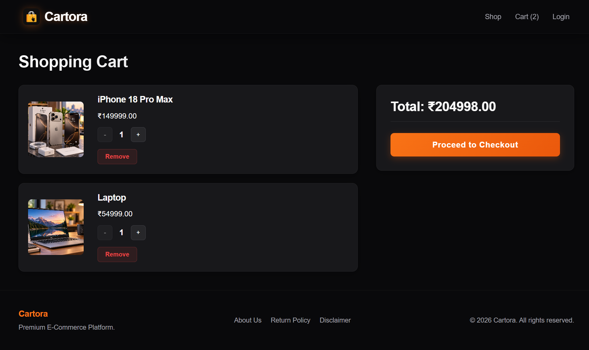
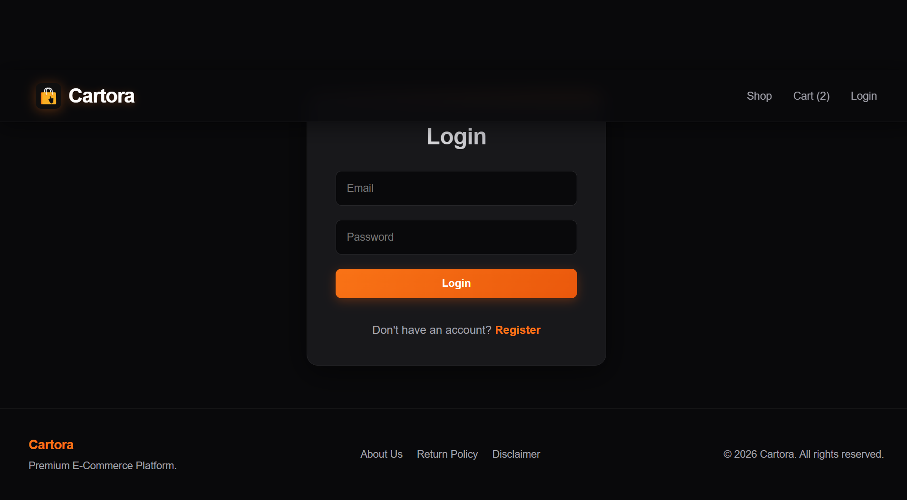
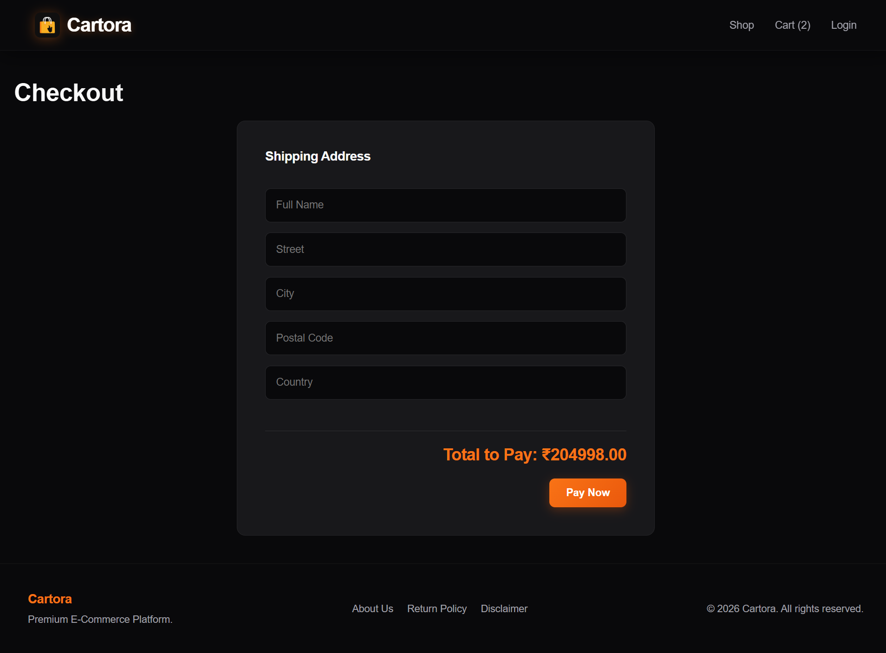
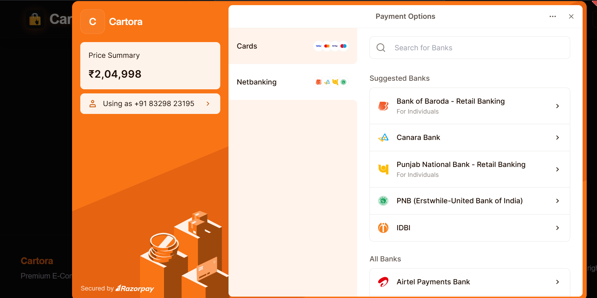
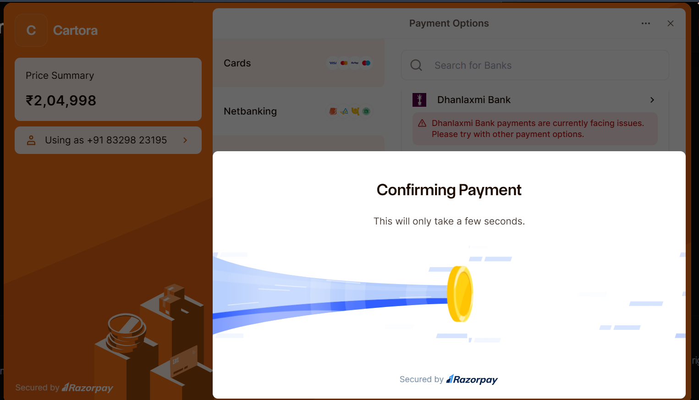
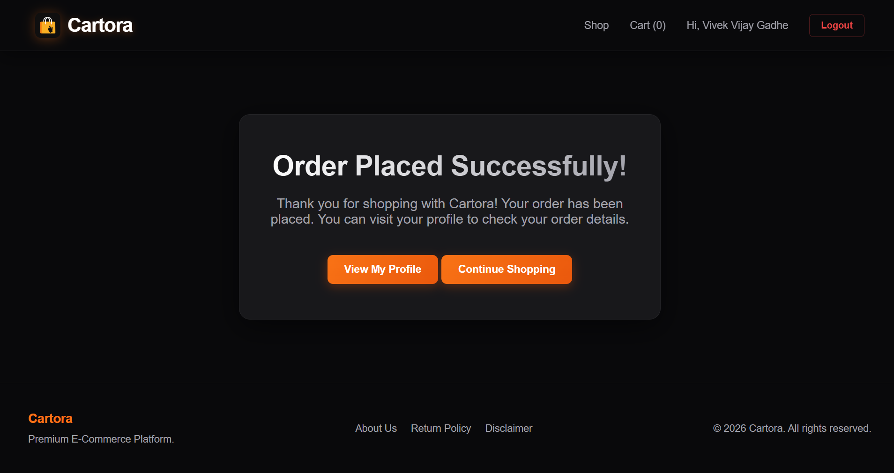
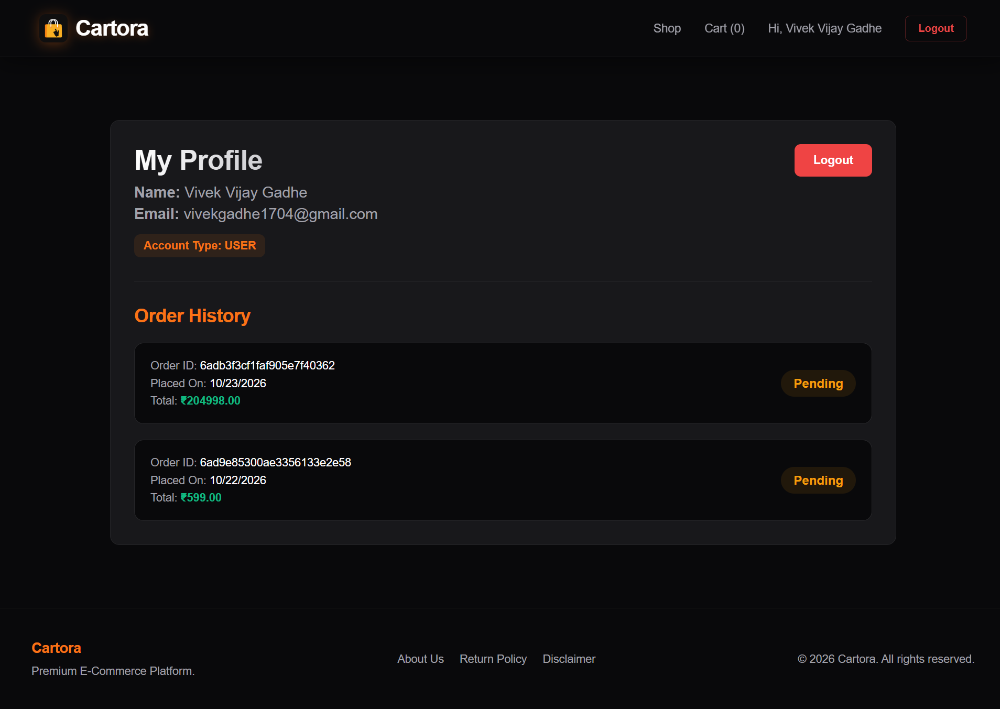

<div align="center">

  

  # 🛍️ Cartora

  ### A Modern MERN Stack E-Commerce Platform

  **Discover products. Shop seamlessly. Pay securely. Track every order.**

  Cartora is a full-stack e-commerce web application built with the MERN stack. It provides a complete shopping experience, including user authentication, product discovery, shopping cart management, checkout, Razorpay payment integration, order history, and administrative product and order management.

   <br />

  <!-- Technology Badges -->

  
  
  
  
  
  
  
  
  
  

  <br />

  **Full-Stack Development · REST APIs · Payment Integration · Database Management**

  <br />

  [📸 Screenshots](#-screenshots) ·
  [✨ Features](#-key-features) ·
  [🏗️ Architecture](#️-system-architecture) ·
  [⚙️ Installation](#-getting-started)

</div>

---

## 📑 Table of Contents

- [Overview](#-overview)
- [Problem Statement](#-problem-statement)
- [Solution](#-solution)
- [Screenshots](#-screenshots)
- [Key Features](#-key-features)
- [Complete E-Commerce Workflow](#-complete-e-commerce-workflow)
- [Technology Stack](#️-technology-stack)
- [System Architecture](#️-system-architecture)
- [Project Structure](#-project-structure)
- [Getting Started](#-getting-started)
- [Environment Variables](#-environment-variables)
- [Payment Integration](#-payment-integration)
- [Performance Optimizations](#-performance-optimizations)
- [Security Considerations](#-security-considerations)
- [Future Improvements](#-future-improvements)
- [Author](#-author)
- [License](#-license)

---

## 📖 Overview

Cartora is a full-stack e-commerce application designed to provide a convenient and organized online shopping experience.

The application combines a React-based frontend, a Node.js and Express backend, and a MongoDB database to support the core operations of an online store.

Customers can explore products, manage their shopping carts, proceed through checkout, complete simulated payments using Razorpay Test Mode, and review their order history.

The application also provides administrative functionality for managing store data and orders, according to the features implemented in the project.

### 🎯 Project Objectives

- Build a full-stack e-commerce application using the MERN stack.
- Implement user authentication and account management.
- Create a seamless product discovery and shopping experience.
- Manage shopping carts and checkout operations.
- Integrate a payment gateway with server-side payment verification.
- Store and retrieve order information using MongoDB.
- Provide administrative interfaces for managing the store.
- Improve frontend loading through code splitting and resource optimization.
- Develop a maintainable application with separate frontend and backend components.

---

## 🎯 Problem Statement

Online shopping applications require more than an attractive product catalogue. They must coordinate several interconnected processes, including authentication, product browsing, cart management, checkout, payment processing, order creation, and order tracking.

Implementing these processes requires communication between the frontend, backend APIs, database, and payment gateway.

Cartora addresses these requirements by bringing the major e-commerce operations together in one web application.

## 💡 Solution

Cartora provides an integrated shopping workflow in which customers can discover products, manage their selections, complete checkout, process payments through Razorpay Test Mode, and view their placed orders.

The backend manages application requests, database operations, and payment verification, while the React frontend provides the user interface.

The result is a practical full-stack project demonstrating how different web technologies work together to support an e-commerce application.

---

## 📸 Screenshots

The following screenshots showcase the application's interface and important shopping workflows.

### 🏠 Homepage

The homepage introduces the Cartora shopping experience and provides access to the store's products and navigation.


### 🛍️ Product Listing

Browse the available products and explore the shopping catalogue.


### 📦 Product Details

View an individual product's information before adding it to the shopping cart.


### 🛒 Shopping Cart

Review selected products and the cart information before proceeding to checkout.



### 🔐 Authentication

Account registration and sign-in interfaces support the application's authentication workflow.



### 💳 Checkout

Review checkout information before initiating the payment process.



### 💰 Razorpay Payment Gateway

Cartora integrates Razorpay Checkout to initiate payment processing.





### ✅ Payment Success

View the application's payment confirmation and order completion interface after a successful test transaction.



### 📋 Order History

Customers can review their previously placed orders and the available order information.



---

## ✨ Key Features

### 🔐 1. User Authentication

Cartora provides account-related functionality for customers.

- User registration and sign-in.
- Authentication-related frontend and backend integration.
- Access to account-related shopping functionality.
- Integration with protected application features where configured.

The actual authentication mechanism and authorization rules depend on the backend implementation.

### 🛍️ 2. Product Discovery

The application provides a shopping interface for discovering available products.

- Product listing and browsing.
- Product detail pages.
- Product images and information.
- Navigation between shopping pages.
- Product selection for the shopping cart.

### 🛒 3. Shopping Cart Management

The shopping cart allows customers to review the products they intend to purchase.

- Add products to the cart.
- Review selected products.
- Manage cart contents using the available controls.
- Review cart totals.
- Proceed to checkout.

### 💳 4. Checkout and Payment Integration

Cartora integrates Razorpay Checkout to support the payment workflow.

- Initiate payment through the backend.
- Create a Razorpay payment order.
- Open the Razorpay Checkout interface.
- Process simulated transactions using Test Mode.
- Verify payment information on the backend.
- Continue with application order processing after successful verification.

Payment verification is important because the application should not rely exclusively on the frontend's payment-success callback.

### 📦 5. Order Management

Cartora connects the checkout and payment workflows with order management.

- Create an application order after the required checkout and payment checks.
- Store order information in the database.
- Associate orders with the relevant customer where implemented.
- Retrieve order information for the order history interface.
- Display available order details and status.

### 📋 6. Order History

Customers can review information about previously placed orders.

Depending on the order data available, the interface can display:

- Order identification information.
- Purchased products.
- Order amount.
- Order date.
- Order status.

The order history provides a convenient way to review previous purchases.

### 👨‍💼 7. Administrative Functionality

Cartora includes administrative functionality for managing the store.

The available functionality depends on the implemented admin pages and backend authorization.

Relevant administrative operations may include:

- Product management.
- Product creation and editing.
- Product catalogue maintenance.
- Order management.
- Reviewing order information.
- Managing available store data.

Only administrative operations implemented in the current version should be considered part of the application's feature set.

### ⚡ 8. Frontend Performance Improvements

Several frontend loading optimizations have been implemented.

- Lazy loading of React page components.
- Lazy loading of product images.
- Asynchronous image decoding.
- On-demand loading of the Razorpay Checkout script.
- Optimized Google Fonts loading using resource hints.

These changes help avoid loading certain resources before they are needed.

---

## 🔄 Complete E-Commerce Workflow

Cartora connects the main shopping operations into a single workflow, from customer authentication to payment and order history.

### 1. User Registration and Authentication

The customer accesses the application and uses the available registration or sign-in interface.

The frontend communicates with the backend to process authentication requests.

After successful authentication, the customer can access the relevant shopping functionality according to the application's authentication and authorization rules.

### 2. Product Discovery

The customer visits the shopping section and browses the available products.

The customer can open individual product pages to review product information and select products for purchase.

### 3. Shopping Cart

The customer adds selected products to the shopping cart.

The cart presents the selected items and relevant pricing information.

Before continuing, the customer can review the cart and make any available changes.

### 4. Checkout

The customer proceeds to checkout.

The frontend initiates the checkout process and requests the required payment information from the backend.

The backend creates the corresponding Razorpay payment order using its configured payment credentials.

### 5. Razorpay Payment

The application opens Razorpay Checkout when the payment process is initiated.

In Test Mode, the customer can simulate a payment using the payment methods and test credentials supported by Razorpay.

No real financial transaction takes place when the payment is processed entirely in Test Mode.

### 6. Payment Verification

After the payment interaction, the frontend submits the required payment information to the backend for verification.

The backend verifies the payment signature using the configured Razorpay secret.

The backend also checks the payment's captured status as part of the implemented verification flow.

This server-side verification helps prevent the frontend from treating an unverified payment response as sufficient proof of successful payment.

### 7. Order Creation

After successful payment verification, the application continues its order-processing workflow.

The order information is saved in MongoDB through the backend.

The resulting order can then be retrieved through the application's order-related functionality.

### 8. Order History

The customer opens the order history or relevant account page to review previously placed orders.

The application displays the available order details, including product information, amount, and status where supported.

### 🔁 Workflow Diagram

```mermaid
flowchart TD
    A["Customer Opens Cartora"] --> B["Register or Sign In"]
    B --> C["Browse Products"]
    C --> D["View Product Details"]
    D --> E["Add Products to Cart"]
    E --> F["Review Shopping Cart"]
    F --> G["Proceed to Checkout"]
    G --> H["Backend Creates Razorpay Order"]
    H --> I["Razorpay Checkout"]
    I --> J{"Payment Successful?"}
    J -- No --> K["Handle Payment Failure or Retry"]
    K --> I
    J -- Yes --> L["Backend Verifies Payment"]
    L --> M{"Verification Successful?"}
    M -- No --> N["Reject Unverified Payment"]
    M -- Yes --> O["Create Application Order"]
    O --> P["Save Order in MongoDB"]
    P --> Q["Display Order Confirmation"]
    Q --> R["Customer Views Order History"]

  ```

---

## 🛠️ Technology Stack

Cartora is built using the MERN stack, with additional technologies for payment integration, development, and version control.

### 🎨 Frontend

| Technology | Purpose |
|---|---|
| React.js | Building reusable UI components and interactive pages |
| JavaScript | Implementing frontend application logic |
| HTML5 | Structuring web page content |
| CSS3 | Styling and responsive layouts |
| React Router | Client-side navigation, if used in the project |

### ⚙️ Backend

| Technology | Purpose |
|---|---|
| Node.js | JavaScript runtime for server-side development |
| Express.js | Building backend routes and REST APIs |

### 🗄️ Database

| Technology | Purpose |
|---|---|
| MongoDB | Storing application data |
| MongoDB Atlas | Cloud database hosting, if configured |

### 💳 Payment Integration

| Technology | Purpose |
|---|---|
| Razorpay | Payment gateway integration and Test Mode transactions |

### 🧰 Development and Version Control

| Technology | Purpose |
|---|---|
| npm | Managing project dependencies and scripts |
| Git | Tracking source code changes |
| GitHub | Hosting and managing the project repository |

---

---

## 📁 Project Structure

Cartora follows a modular project structure with separate frontend and backend applications. The frontend manages the user interface, while the backend handles API requests, business logic, database operations, and payment processing.

```text
Cartora/
├── backend/
│   ├── config/
│   │   ├── cloudinary.js
│   │   └── db.js
│   ├── controllers/
│   │   ├── analyticsController.js
│   │   ├── authController.js
│   │   ├── orderController.js
│   │   ├── paymentController.js
│   │   └── productController.js
│   ├── middleware/
│   │   ├── adminMiddleware.js
│   │   └── authMiddleware.js
│   ├── models/
│   │   ├── Order.js
│   │   ├── PaymentAttempt.js
│   │   ├── Product.js
│   │   ├── Review.js
│   │   └── User.js
│   ├── routes/
│   │   ├── analyticsRoutes.js
│   │   ├── authRoutes.js
│   │   ├── orderRoutes.js
│   │   ├── paymentRoutes.js
│   │   └── productRoutes.js
│   ├── uploads/
│   ├── utils/
│   │   └── sendEmail.js
│   ├── seed.js
│   ├── server.js
│   ├── package.json
│   └── package-lock.json
│
├── frontend/
│   ├── public/
│   │   ├── images/
│   │   │   ├── Cartora-hero.png
│   │   │   ├── CartoraLogo.png
│   │   │   └── profile.jpeg
│   │   └── index.html
│   ├── src/
│   │   ├── admin/
│   │   │   ├── AddProduct.jsx
│   │   │   ├── AdminDashboard.jsx
│   │   │   ├── AdminOrders.jsx
│   │   │   ├── AdminProducts.jsx
│   │   │   ├── AdminUsers.jsx
│   │   │   └── EditProduct.jsx
│   │   ├── components/
│   │   │   ├── Footer.jsx
│   │   │   ├── Navbar.jsx
│   │   │   └── ProductCard.jsx
│   │   ├── context/
│   │   │   └── AuthContext.jsx
│   │   ├── pages/
│   │   │   ├── About.jsx
│   │   │   ├── Cart.jsx
│   │   │   ├── Checkout.jsx
│   │   │   ├── Disclaimer.jsx
│   │   │   ├── Home.jsx
│   │   │   ├── Login.jsx
│   │   │   ├── OrderSuccess.jsx
│   │   │   ├── ProductDetail.jsx
│   │   │   ├── Profile.jsx
│   │   │   ├── Register.jsx
│   │   │   ├── ReturnPolicy.jsx
│   │   │   └── Shop.jsx
│   │   ├── redux/
│   │   │   ├── cartSlice.js
│   │   │   └── store.js
│   │   ├── styles/
│   │   │   ├── auth.css
│   │   │   ├── cart.css
│   │   │   ├── global.css
│   │   │   ├── navbar.css
│   │   │   └── product.css
│   │   ├── App.jsx
│   │   └── index.js
│   ├── package.json
│   └── package-lock.json
│
├── .gitignore
└── README.md
````

### 📂 Backend Directory

| Directory/File | Description                                                                        |
| -------------- | ---------------------------------------------------------------------------------- |
| `config/`      | Database connection and Cloudinary configuration.                                  |
| `controllers/` | Handles authentication, products, orders, payments, and analytics operations.      |
| `middleware/`  | Contains authentication and administrator middleware.                              |
| `models/`      | Defines MongoDB models for users, products, orders, reviews, and payment attempts. |
| `routes/`      | Organizes API endpoints by functionality.                                          |
| `uploads/`     | Directory for uploaded files, depending on the application's implementation.       |
| `utils/`       | Contains reusable backend utilities, including email functionality.                |
| `server.js`    | Backend server entry point.                                                        |
| `seed.js`      | Script for initializing or populating database data.                               |
| `package.json` | Defines backend dependencies and scripts.                                          |

### 🎨 Frontend Directory

| Directory/File    | Description                                                                          |
| ----------------- | ------------------------------------------------------------------------------------ |
| `public/`         | Contains static assets and the main HTML template.                                   |
| `src/admin/`      | Contains administrator-facing pages for managing products, users, and orders.        |
| `src/components/` | Contains reusable interface components such as the navbar, footer, and product card. |
| `src/context/`    | Provides application-wide authentication context.                                    |
| `src/pages/`      | Contains the main shopping pages and customer-facing interfaces.                     |
| `src/redux/`      | Manages shopping cart state and Redux store configuration.                           |
| `src/styles/`     | Contains CSS files for application styling.                                          |
| `App.jsx`         | Main React application component.                                                    |
| `index.js`        | Frontend entry point.                                                                |
| `package.json`    | Defines frontend dependencies and scripts.                                           |

---

````md
---

## ⚙️ Getting Started

Follow these steps to set up and run Cartora on your local machine.

### 📋 Prerequisites

Before starting, ensure you have installed:

- **Node.js** — JavaScript runtime.
- **npm** — Package manager included with Node.js.
- **MongoDB** — A local MongoDB instance or a MongoDB Atlas connection.
- **Git** — For cloning the repository.

A Razorpay account is required to configure the payment integration in Test Mode.

### 1. Clone the Repository

```bash
git clone <YOUR_GITHUB_REPOSITORY_URL>
cd Cartora
````

Replace `<YOUR_GITHUB_REPOSITORY_URL>` with your actual GitHub repository URL.

### 2. Install Backend Dependencies

Open a terminal in the project root and run:

```bash
cd backend
npm install
```

### 3. Install Frontend Dependencies

Open another terminal from the project root and run:

```bash
cd frontend
npm install
```

### 4. Configure Environment Variables

Create the required `.env` files for the backend and frontend.

Configure the database connection, authentication settings, and Razorpay credentials according to your application's implementation.

Refer to the [Environment Variables](#-environment-variables) section for further details.

**Important:** Never commit real API keys, database credentials, or other secrets to GitHub.

### 5. Start the Backend

Open a terminal in the `backend` directory and run the command configured in your backend `package.json`.

For example, if your backend defines a `start` script:

```bash
npm start
```

Alternatively, if it defines a development script:

```bash
npm run dev
```

### 6. Start the Frontend

Open another terminal in the `frontend` directory and run:

```bash
npm start
```

If the frontend uses Create React App, this typically starts the development server at:

http://localhost:3000

### 7. Open Cartora

Open the frontend URL displayed in your terminal, typically:

http://localhost:3000

Ensure the backend and database are running and the required environment variables are configured.


---

## 🔐 Environment Variables

Cartora uses environment variables to configure database connectivity, authentication, payment processing, and other external services.

Create the required `.env` files in the appropriate directories and configure them according to your application's implementation.

### Backend Configuration

Create a `.env` file inside the `backend/` directory.

```env
# Server Configuration
PORT=5000

# MongoDB Configuration
MONGO_URI=your_mongodb_connection_string

# Authentication
JWT_SECRET=your_jwt_secret

# Razorpay Payment Gateway
RAZORPAY_KEY_ID=your_razorpay_key_id
RAZORPAY_KEY_SECRET=your_razorpay_key_secret

# Cloudinary Configuration
CLOUDINARY_CLOUD_NAME=your_cloudinary_cloud_name
CLOUDINARY_API_KEY=your_cloudinary_api_key
CLOUDINARY_API_SECRET=your_cloudinary_api_secret

# Email Configuration
EMAIL_USER=your_email_address
EMAIL_PASS=your_email_app_password
````


### Frontend Configuration

If your frontend requires environment variables, create a `.env` file inside the `frontend/` directory.

For a Create React App project, frontend variables exposed to browser code generally use the `REACT_APP_` prefix.

Example:

```env
REACT_APP_API_URL=http://localhost:5000
REACT_APP_RAZORPAY_KEY_ID=your_razorpay_key_id
```

Use the exact variable names referenced in your frontend code. Only expose values intended to be public, such as a Razorpay Key ID. **Never expose secret keys in frontend variables.**

### Security Best Practices

* Never commit `.env` files to a public repository.
* Add `.env` and `.env.*` patterns to `.gitignore`, while allowing a sanitized `.env.example` if needed.
* Never expose MongoDB credentials, JWT secrets, Razorpay Key Secrets, or Cloudinary API secrets.
* Use Razorpay Test Mode credentials for development.
* Configure production environment variables through your deployment platform's environment settings.


---

## 💳 Payment Integration

Cartora integrates **Razorpay** to support the checkout and payment workflow. The application uses Razorpay Test Mode to simulate transactions during development.

### 🔄 Payment Workflow

1. **Initiate Checkout:** The customer proceeds to checkout and initiates the payment process.
2. **Create Payment Order:** The frontend requests a payment order from the backend.
3. **Open Razorpay Checkout:** The application opens the Razorpay Checkout interface using the returned order details.
4. **Process Test Payment:** The customer completes a simulated transaction using the available Razorpay test options.
5. **Verify Payment:** The frontend submits the payment response to the backend for server-side verification.
6. **Validate Signature:** The backend verifies the payment signature using the Razorpay Key Secret.
7. **Process Order:** After successful verification, the application continues with order creation and storage.
8. **Display Confirmation:** The frontend displays the relevant payment or order confirmation.

### 🔌 Payment API Endpoints

The payment workflow uses the following endpoints in the current project:

| Endpoint | Purpose |
|---|---|
| `POST /api/payment/order` | Initiates payment order creation. |
| `POST /api/payment/verify` | Submits payment information for backend verification. |
| `POST /api/orders` | Handles order creation through the order API. |

> **Note:** Confirm the HTTP methods and route paths against your backend route files before publishing this table.

### 🔐 Payment Security

- Keep the Razorpay Key Secret on the backend.
- Verify payment signatures on the server.
- Do not rely solely on frontend callbacks to confirm successful payment.
- Validate payment information before creating an order.
- Use Test Mode credentials during development.
- Never commit payment credentials or other secrets to GitHub.

### 🧪 Test Mode

Razorpay Test Mode allows developers to test the payment workflow without processing real financial transactions.

The integration can be tested by initiating checkout, completing a simulated payment, verifying the payment response, and confirming that the application handles order creation correctly.

---

## ⚡ Performance Optimizations

Cartora incorporates frontend optimization techniques to reduce unnecessary resource loading and improve the user experience.

### 1. Lazy Loading React Components
- Uses `React.lazy()` to load selected page components when required.
- Uses `Suspense` to handle loading states while components are being loaded.
- Helps reduce the amount of JavaScript loaded initially when code splitting is configured correctly.

### 2. Lazy Loading Product Images
- Uses lazy loading for product images where appropriate.
- Defers loading of off-screen images until they are needed.
- Helps reduce unnecessary initial network requests.

### 3. Asynchronous Image Decoding
- Uses asynchronous image decoding where configured.
- Allows the browser to decode images without unnecessarily blocking other rendering work.

### 4. On-Demand Razorpay Script Loading
- Loads the Razorpay Checkout script when the payment functionality is needed.
- Avoids loading the payment script before the customer initiates the relevant workflow.

### 5. Optimized Google Fonts Loading
- Uses resource hints such as `preconnect` for Google Fonts.
- Helps establish connections to external font resources earlier.

### Benefits

- Reduces unnecessary initial resource loading.
- Supports code splitting and more efficient page loading.
- Avoids loading certain resources before they are needed.
- Helps provide a smoother shopping experience.

---

## 🔐 Security Considerations

Cartora incorporates backend authentication, authorization middleware, and server-side payment verification as part of its application architecture.

### 1. Authentication and Authorization
- Uses authentication middleware for protected backend operations.
- Includes administrator middleware for access control.
- Restricts protected operations according to the application's authorization rules.

### 2. Environment Variable Protection
- Stores sensitive configuration values in environment variables.
- Keeps database credentials, authentication secrets, and payment secrets out of frontend code.
- Excludes `.env` files from version control.

### 3. Payment Security
- Verifies payment signatures on the backend.
- Avoids relying solely on frontend payment callbacks.
- Performs payment validation before proceeding with order processing, according to the implemented workflow.

### 4. Database Security
- Uses a MongoDB database to store application data.
- Keeps database connection credentials in environment variables.
- Requires appropriate database access permissions and secure connection settings.

### 5. Administrative Access
- Includes dedicated administrator middleware.
- Separates administrative functionality from customer-facing features.
- Requires backend authorization checks for sensitive administrative operations.

### Security Best Practices
- Never expose private API keys or secrets in frontend code.
- Never commit credentials to a public repository.
- Validate incoming requests on the backend.
- Apply appropriate authorization checks to protected routes.
- Use HTTPS and secure environment configuration when deploying the application.

---

## 🚀 Future Improvements

Although Cartora provides core e-commerce functionality, several enhancements could further improve its capabilities, scalability, and user experience.

- **🔍 Advanced Product Search:** Introduce advanced search, filtering, sorting, and product discovery options.
- **❤️ Wishlist Functionality:** Allow customers to save products for future purchases.
- **⭐ Product Reviews and Ratings:** Expand customer feedback and product rating capabilities.
- **📦 Enhanced Order Tracking:** Provide more detailed order status updates and shipment tracking.
- **📧 Email Notifications:** Improve automated notifications for registration, payment confirmation, and order updates.
- **📊 Advanced Analytics:** Expand the administrative dashboard with additional sales reports and business insights.
- **📱 Progressive Web App (PWA):** Improve the mobile experience with installable application features.
- **🧪 Automated Testing:** Add unit, integration, and end-to-end tests for critical application workflows.
- **🔒 Additional Security Enhancements:** Strengthen input validation, rate limiting, and other security controls where needed.
- **☁️ Deployment and Scalability:** Improve deployment automation, monitoring, and application scalability.

These enhancements represent potential future development opportunities and are not claims about features currently implemented in Cartora.

---

## 👨‍💻 Author

**Vivek Vijay Gadhe**

Full-Stack Developer | MERN Stack Developer

Passionate about building full-stack web applications, developing REST APIs, integrating databases, and creating practical software solutions.

### Connect With Me

- **GitHub:** [Your GitHub Profile](https://github.com/vivekgadhe)
- **LinkedIn:** [Your LinkedIn Profile](https://www.linkedin.com/in/vivekgadhe)


---

<div align="center">

  ## 💙 Thank You for Visiting Cartora!

  **More than an online store — a journey in full-stack development.**

  Thank you for taking the time to explore my project.

  Cartora represents my passion for building practical web applications,
  solving real-world problems, and continuously learning new technologies.

  If you found this project interesting, please consider giving it a ⭐ on GitHub!

  Your feedback, suggestions, and contributions are always welcome.

  <br />

  **Built with 💻, powered by curiosity, and driven by continuous learning.**

  <br />

  ### 🛍️ Cartora — Discover Products. Shop Seamlessly. Pay Securely.

  **Developed by Vivek Vijay Gadhe**

  <br />

  [⬆️ Back to Top](#-cartora)

</div>

---


